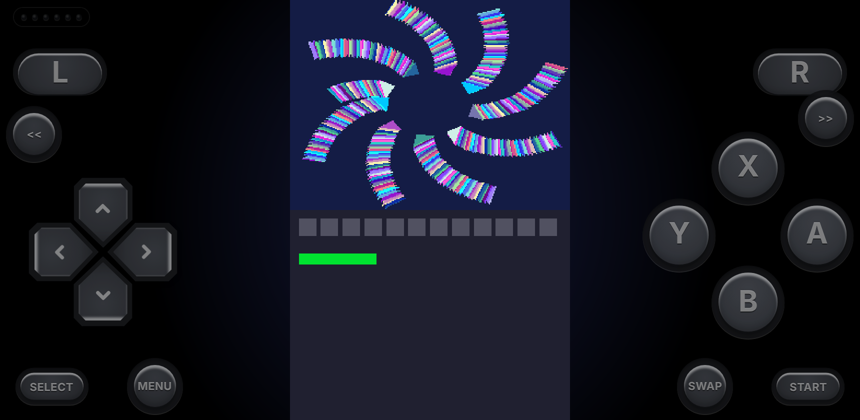

# Brad's Underover

A Nintendo DS emulator for Android, built from Brad's Bullpup. Same controller, same menus, same Look tab, but the core underneath is melonDS, the most accurate open source DS emulator, compiled to WebAssembly. The whole app is one offline HTML file in a tiny native WebView shell. The APK is about 720 KB.

**Play it in your browser:** https://shanesenbradz.github.io/Brads-Underover/

<p>


</p>

No games are included. Load games you dumped from cartridges you own.

## Install

On your phone, open the **[download page](https://shanesenbradz.github.io/Brads-Underover/download/)** and tap Download APK. Open the file and allow installs from your browser if Android asks. Play Protect may warn about an unknown developer, since it isn't from the Play Store. Tap "Install anyway".

It runs on Android 7 and up and installs next to Brad's Bullpup (it's a separate app, com.bradz.underover). It updates itself from System, Updates.

You can also skip the install and [run it in the browser](https://shanesenbradz.github.io/Brads-Underover/). It works offline after the first visit. release/Brads_Underover_1.0.html is the same thing as one file you can keep on a phone or PC.

## The two screens

The Look tab has a Screens section with three layouts:

- **Stacked**, like holding a DS. In portrait the screens take the top of the phone and the controller sits underneath. In landscape they stand in the middle with the controls either side.
- **Side by side**, for tablets and controllers.
- **One at a time.** Only one screen shows, as big as the phone allows. Press **SWAP** and the touch screen becomes the main screen; press it again to go back. Set the SWAP button to "Hold to peek" if you'd rather see the touch screen only while you hold it.

In the stacked and side by side layouts SWAP puts the touch screen first. There's a gap setting too, if you want the hinge back.

Tap the touch screen with your finger (or the mouse on a PC) and it's the stylus. Drag off the edge and it keeps pressing at the edge, like the real screen. In portrait the touch buttons live below the screens, so the stylus has the screens to itself.

## What it does

Everything Bullpup does that makes sense on a DS, plus the DS parts:

- X and Y buttons, the stylus, a MIC button that blows into the microphone (or use the phone's real mic), and closing the lid for games that react to it
- Save states in 9 slots with screenshots, stored gzipped (a DS state is about 6 MB raw, around 100 KB packed), an auto snapshot when you leave a game, and undo for the last save or load
- Rewind, fast forward up to 12x and slow motion
- In-game saves (EEPROM, flash and FRAM) stored on the phone automatically, with .sav import and export so saves from melonDS, DeSmuME and DraStic move over
- Action Replay DS cheats run by the core every frame, so conditionals, loops, pointer codes and button activators work. Raw AAAAAAAA:VVVV codes too
- RAM search over the 4 MB of main RAM, with Lock to turn what you find into a cheat
- Your DS profile: nickname, language, birthday and favourite colour, which lots of games read
- Sound quality settings: interpolation (none, linear, cosine, cubic or SNES Gaussian) and 10 or 16 bit output, on top of Bullpup's reverb, EQ, stereo width and limiter
- The library shows each game's own icon and title from its banner
- Screen shaders, colour correction, frame blending, frame skip
- Controllers over Bluetooth or USB with remapping (the left stick clicks swap screens and the right one blows the mic by default), keyboard remapping, turbo, and the touch layout editor
- Screenshots and video clips, saved to Downloads/Underover
- One backup file with all saves, states, cheats and settings

The icon is a pixel over/under shotgun, drawn by web/brand/shotgun.py.

## Speed

I went through how the fast DS emulators get their speed before picking the core. DraStic and melonDS on desktop both lean on a JIT that turns ARM code into native code, and WebAssembly can't do that, so the gains here come from everywhere else:

- melonDS is built with -O3, link time optimisation (about 5% faster frames) and WebAssembly SIMD
- The two screens are converted from melonDS's colour format to RGBA and laid out with SIMD in one pass, about 0.06 ms a frame, and only for frames that get shown
- Frame skip goes deeper than in Bullpup: a skipped frame doesn't draw its 2D layers, and the DS renders 3D one frame ahead, so the 3D scene is only rendered for a frame that will actually be shown. Both stay on while a game uses display capture, so nothing breaks
- Rewind diffs the 6 MB states in C with SIMD instead of in JavaScript, about 3 ms per snapshot
- Save states shrank from 19 MB to 6 MB by saving the 4 MB of RAM a DS has instead of the DSi's 16
- The ROM isn't copied into the core, it's handed over, so a 512 MB game needs 512 MB, not a gigabyte
- Sound comes out of the core at the phone's own sample rate, so there's no extra resampling step

On the server I test on (a 2.1 GHz Xeon, one core) the 3D test ROM runs at about 150% of full speed. A recent phone is faster than that per core, but a JIT-less DS emulator is still demanding: heavy 3D games on older phones will need frame skip.

## How it's put together

```
web/            the app: shell.html, app.css, js/ (loaded in filename order)
web/brand/      the pixel shotgun (shotgun.py) and the sticker sprites
vendor/melonds/ melonds.js and melonds.wasm, the patch and the C shim they're built from (see SOURCE.md)
android/        manifest, icons and the WebView shell (MainActivity.java, Updater.java)
tools/          build_core.sh, bundle.py, build_apk.sh, publish.py, store_assets.py
test/           the homebrew test ROM and its source (test/rom), a node benchmark and a Playwright test
dist/           the bundled single-file app
docs/           the GitHub Pages site
release/        signed APKs and HTML builds, one per version
```

melonDS boots games with its built-in FreeBIOS and a generated firmware, so there's no BIOS or firmware to load. Games always boot straight in, with no DS menu.

The test ROM in test/rom is a tiny DS program built with clang and lld, no devkitPro. The top screen spins a ring of 600 3D triangles to load the renderer, and the bottom screen shows a box per button, a health bar, a mic meter and a crosshair under the stylus. A takes 7 health, START writes it to the cart's EEPROM, B beeps.

## Building it yourself

```
./tools/build_core.sh            # vendor/melonds from source (needs Emscripten 3.1.50)
python3 test/rom/build.py        # the test ROM (clang + lld)
python3 tools/bundle.py          # web/ + vendor/ -> dist/Brads_Underover.html and docs/
./tools/build_apk.sh             # dist/Brads_Underover.apk
python3 tools/publish.py "note"  # release/ copies, the download page and docs/version.json
```

build_core.sh works with emsdk, or with an Emscripten checkout plus your system's clang 18 and binaryen 116 built from source, which is how I built this one.

The APK build doesn't need Android Studio, same as Bullpup. Without signing settings the script makes a key in keys/, which is git-ignored. Keep that key: every update has to be signed with it to install over the old version.

Tests:

```
node test/bench.mjs              # speed, input, states and rewind straight on the core
python3 test/e2e.py              # the whole app in headless Chromium
```

The end-to-end test boots the test ROM and checks the keyboard, touch buttons, the stylus in all three layouts, SWAP in one-screen mode, the mic, Action Replay and raw cheats, RAM search, save states, rewind, and that an in-game save survives leaving and coming back.

## What's missing

Local wireless play (DS download play and wireless multiplayer), the DSi mode, GBA slot add-ons, the DS menu and an OpenGL upscaled 3D renderer aren't in yet. Only DS games are supported; DSi-only games won't start. It hasn't been tried across a wide range of phones and commercial games, since the tests run a homebrew ROM in headless Chrome, so expect some games where something is off. Open an issue with the game, the phone model and what you see.

## Credits and licence

Emulation is [melonDS](https://github.com/melonDS-emu/melonDS) by Arisotura and the melonDS team. The app around it is Brad's Bullpup.

Released under the GNU General Public License version 3, the same licence as melonDS.
