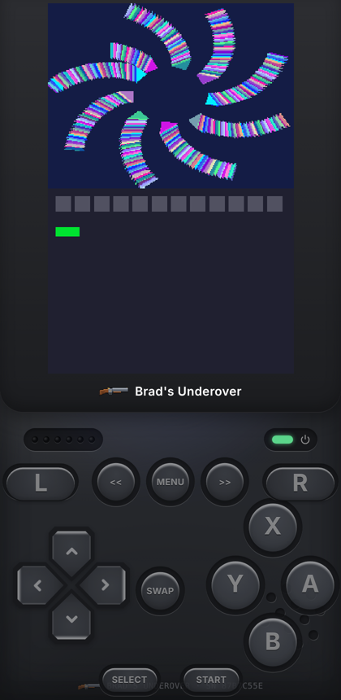

# Brad's Underover

A Nintendo DS emulator for Android, built from Brad's Bullpup. Same controller, same menus, same Look tab, but the core underneath is melonDS, the most accurate open source DS emulator. On 64-bit ARM phones (nearly every phone from the last several years) the app runs melonDS natively with its ARM64 JIT. Everywhere else, and in the browser, it runs melonDS compiled to WebAssembly. The interface is one offline HTML file in a small native WebView shell. The APK is about 2.1 MB.

**Play it in your browser:** https://shanesenbradz.github.io/OverUnder/

<p>


</p>

No games are included. Load games you dumped from cartridges you own.

## Install

On your phone, open the **[download page](https://shanesenbradz.github.io/OverUnder/download/)** and tap Download APK. Open the file and allow installs from your browser if Android asks. Play Protect may warn about an unknown developer, since it isn't from the Play Store. Tap "Install anyway".

It runs on Android 7 and up and installs next to Brad's Bullpup (it's a separate app, com.bradz.underover). It updates itself from System, Updates.

You can also skip the install and [run it in the browser](https://shanesenbradz.github.io/OverUnder/). It works offline after the first visit. release/Brads_Underover_1.1.1.html is the same thing as one file you can keep on a phone or PC.

## The two screens

By default it plays exactly like Bullpup: one screen, the top one, in the same screen area with the same controller under it. Press **SWAP** and the touch screen takes its place; press it again to go back. Set SWAP to "Hold to peek" in Look, Screens if you'd rather see the touch screen only while you hold it.

The classic DS view is still there as an option in Look, Screens: both screens stacked (in landscape they stand in the middle with the controls either side) or side by side, with SWAP putting the touch screen first and an optional gap for the hinge.

Tap the touch screen with your finger (or the mouse on a PC) and it's the stylus. Drag off the edge and it keeps pressing at the edge, like the real screen. In portrait the touch buttons live below the screens, so the stylus has the screens to itself.

## What it does

Everything Bullpup does that makes sense on a DS, plus the DS parts:

- X and Y buttons, the stylus, a MIC button that blows into the microphone (or use the phone's real mic), and closing the lid for games that react to it
- Save states in 9 slots with screenshots, stored gzipped (a DS state is about 6 MB raw, around 100 KB packed), an auto snapshot when you leave a game, and undo for the last save or load
- Rewind, fast forward up to 12x and slow motion
- In-game saves (EEPROM, flash and FRAM) stored on the phone automatically, with .sav import and export so saves from melonDS, DeSmuME and DraStic move over
- Action Replay DS cheats run by the core every frame, so conditionals, loops, pointer codes and button activators work. Raw AAAAAAAA:VVVV codes too
- RAM search over the 4 MB of main RAM, with Lock to turn what you find into a cheat
- Your DS profile: nickname, language, birthday and favourite colour, which lots of games read
- Sound quality settings: interpolation (none, linear, cosine, cubic or SNES Gaussian) and 10 or 16 bit output, on top of Bullpup's reverb, EQ, stereo width and limiter
- The library shows each game's own icon and title from its banner
- Screen shaders, colour correction, frame blending, frame skip
- Controllers over Bluetooth or USB with remapping (the left stick clicks swap screens and the right one blows the mic by default), keyboard remapping, turbo, and the touch layout editor
- Screenshots and video clips, saved to Downloads/Underover
- One backup file with all saves, states, cheats and settings

The icon is a pixel over/under shotgun, drawn by web/brand/shotgun.py.

## Speed

Version 1.2 moved the Android app onto a native build of melonDS with its JIT. In 1.1, Pokémon HeartGold couldn't hold full speed. The WebAssembly core has to interpret every ARM instruction one at a time, because WebAssembly can't generate code at run time. DraStic and melonDS on desktop are fast because of a JIT that turns the game's ARM code into native code as it runs, so that's what the app uses now on arm64 phones:

- **The ARM64 JIT.** melonDS's own recompiler (by RSDuck), built with the NDK into native/arm64-v8a/libunderover.so. With fast memory on, the DS address space is mapped straight onto the phone's MMU, so most memory accesses in JIT code are a single load or store
- **The 3D renderer on its own thread**, and both the emulation thread and the 3D thread run at display priority
- **The picture never goes through the page.** The app draws it in a GL view under the WebView, using the exact GLSL the Look tab's shaders use, and the page cuts a hole over #screen so the controls, HUD and menus still sit on top. Only the sound (about 4 KB a frame) and the odd save come back to the page as base64
- **The ROM is copied over once.** The first boot of a game hands it to the app in 4 MB pieces, and the app keeps the three most recently played ones in its own storage, so later boots skip the copy. Save states are gzipped in C before they cross (about 90 KB instead of 6 MB)
- **A safety net.** If the app closes while a game is starting or in its first five seconds, the next start turns Fast memory off, then the JIT, then switches to the WebAssembly core, and says so. All three are switches in System, Performance

I couldn't test 1.2 on a real phone before releasing it. The JIT core was checked on the test ROM under qemu-aarch64 (with the JIT off and on, fast memory included), and the page's whole native path was checked in headless Chromium against a stand-in bridge. If something is off on your phone, the switches above are the way back.

What the WebAssembly core does to keep up, for the browser and for phones that aren't arm64:

- **Two cores.** The installed app runs a threaded build of melonDS: the 3D scene is drawn on a second CPU core (a Web Worker sharing memory) while the game runs on the first. On the 3D test that's about 25% less work on the main core. It needs a cross-origin isolated page, so the Android app sends the headers for it and the website's service worker adds them after the first visit. A plain HTML file falls back to the single-threaded core
- **Pacing locked to the screen.** Bullpup topped up its sound buffer by running two to four frames at once when it ran low. A GBA frame is cheap, so nobody saw it. A DS frame is 10 ms or more of work, so in a game like HeartGold those bursts showed as judder. Now wall time decides how many frames run, never more than one per screen refresh while the phone keeps up, and the sound is resampled up to half a percent faster or slower to hold its buffer steady. Every refresh of a 60 Hz screen gets a new picture, every other one on 120 Hz
- melonDS is built with -O3, link time optimisation and WebAssembly SIMD
- Reads from main RAM and the ARM7's own RAM skip melonDS's address decoder and go straight to memory
- The screens are converted to RGBA and laid out with SIMD, about 0.06 ms a frame, and only for frames that get shown
- Frame skip leaves out a skipped frame's 2D layers, and the 3D scene is only rendered for frames that will be shown. Both stay on while a game uses display capture
- Rewind diffs states in C with SIMD, save states are 6 MB instead of 19, and the ROM is handed to the core instead of copied

System, Performance shows which core is running (native with the JIT, or WebAssembly) and how long a frame takes on your phone (16.7 ms is full speed).

## How it's put together

```
web/            the app: shell.html, app.css, js/ (loaded in filename order)
web/brand/      the pixel shotgun (shotgun.py) and the sticker sprites
vendor/melonds/ melonds.js and melonds.wasm, the patch and the C shim they're built from (see SOURCE.md)
native/         the native core: uo_core.cpp (melonDS API), uo_jni.cpp, the Android JIT patch, the built .so files
android/        manifest, icons, the WebView shell (MainActivity.java, Updater.java) and the native side (NativeCore, CoreBridge, VideoView)
tools/          build_core.sh, build_native.sh, bundle.py, build_apk.sh, publish.py, store_assets.py
test/           the homebrew test ROM and its source (test/rom), a node benchmark and a Playwright test
dist/           the bundled single-file app
docs/           the GitHub Pages site
release/        signed APKs and HTML builds, one per version
```

melonDS boots games with its built-in FreeBIOS and a generated firmware, so there's no BIOS or firmware to load. Games always boot straight in, with no DS menu.

The test ROM in test/rom is a tiny DS program built with clang and lld, no devkitPro. Like a real game its ARM7 sleeps until each VBlank. The top screen spins a ring of 600 3D triangles to load the renderer, and the bottom screen shows a box per button, a health bar, a mic meter and a crosshair under the stylus. A takes 7 health, START writes it to the cart's EEPROM, B beeps.

## Building it yourself

```
./tools/build_core.sh            # vendor/melonds from source (needs Emscripten 3.1.50)
./tools/build_native.sh          # native/ from source (needs the Android NDK, see below)
python3 test/rom/build.py        # the test ROM (clang + lld)
python3 tools/bundle.py          # web/ + vendor/ -> dist/Brads_Underover.html and docs/
./tools/build_apk.sh             # dist/Brads_Underover.apk
python3 tools/publish.py "note"  # release/ copies, the download page and docs/version.json
```

build_core.sh works with emsdk, or with an Emscripten checkout plus your system's clang 18 and binaryen 116 built from source, which is how I built this one.

build_native.sh takes the NDK from ANDROID_NDK_HOME (r27 or newer). It also works with a plain clang 18 and lld plus a copy of the NDK's sysroot and clang resource folder in NDK_SYSROOT_DIR, which is how I built 1.2. `./tools/build_native.sh test` also builds the core for aarch64 Linux and runs the test ROM under qemu-aarch64 with the JIT off and on (needs g++-aarch64-linux-gnu and qemu-user).

The APK build doesn't need Android Studio, same as Bullpup. Without signing settings the script makes a key in keys/, which is git-ignored. Keep that key: every update has to be signed with it to install over the old version.

Tests:

```
node test/bench.mjs              # speed, input, states and rewind straight on the core
python3 test/e2e.py              # the whole app in headless Chromium (single-threaded core)
python3 test/serve.py 8765 &     # docs/ with the isolation headers, then:
URL=http://127.0.0.1:8765/ EXPECT_MT=1 python3 test/e2e.py   # the same with the threaded core
NATIVE_MOCK=1 python3 test/e2e.py   # the page's native-core path, against test/native_mock.js
```

The end-to-end test boots the test ROM and checks the keyboard, touch buttons, the stylus in all three layouts, SWAP in one-screen mode, the mic, Action Replay and raw cheats, RAM search, save states, rewind, and that an in-game save survives leaving and coming back.

## What's missing

Recording a clip with the native core works but costs speed while it records, because every frame's pixels have to come back to the page for the recorder. Local wireless play (DS download play and wireless multiplayer), the DSi mode, GBA slot add-ons, the DS menu and an OpenGL upscaled 3D renderer aren't in yet. Only DS games are supported; DSi-only games won't start. It hasn't been tried across a wide range of phones and commercial games, since the tests run a homebrew ROM in headless Chrome, so expect some games where something is off. Open an issue with the game, the phone model and what you see.

## Credits and licence

Emulation is [melonDS](https://github.com/melonDS-emu/melonDS) by Arisotura and the melonDS team. The app around it is Brad's Bullpup.

Released under the GNU General Public License version 3, the same licence as melonDS.
